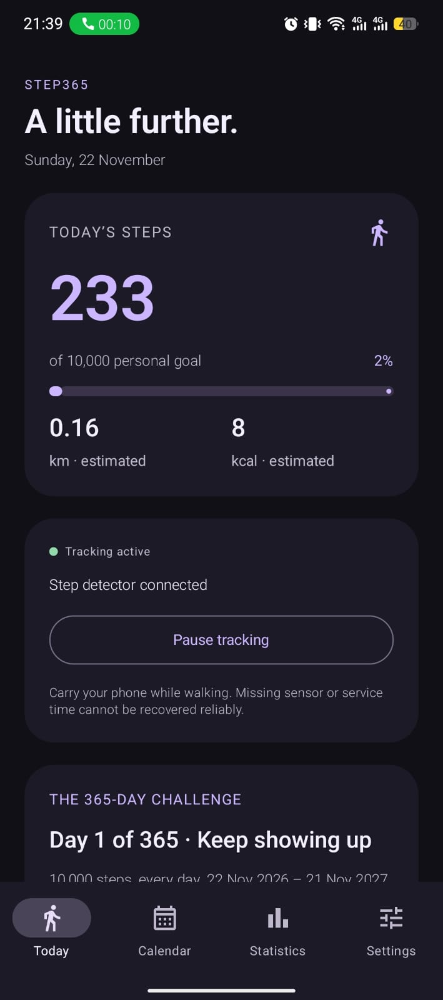
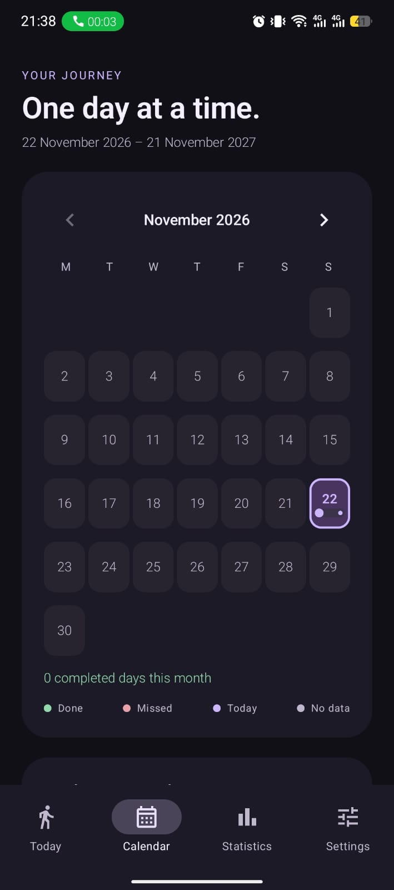
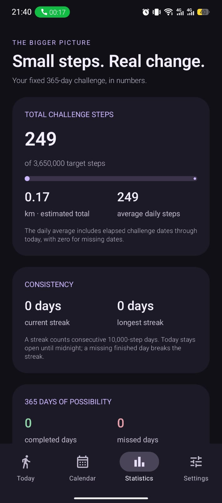

# Step365

**A minimalist native Android step tracker built around one daily goal.**

Step365 tracks steps and progress through a fixed 365-day walking challenge. It keeps the daily count, estimates, and challenge history in one place, without advertising, accounts, or subscriptions.

## Problem and solution

Fitness apps can make a simple question—“How far along am I today?”—harder to answer with ads, extra metrics, and complicated navigation. Step365 puts the daily step count first, then lets users explore the calendar or statistics when they want more detail. The home-screen widget makes progress visible without opening the app.

The challenge runs from **November 22, 2026 through November 21, 2027**. Its target stays at **10,000 steps per day** even when a user changes their personal dashboard goal. The calendar distinguishes a finished day below goal with reliable coverage from a day with incomplete tracking.

## My role

I conceived Step365, defined its requirements, configured and tested it on a physical Android phone, evaluated its interface, and iterated on the user experience. I used AI assistance during development, including implementation and automated verification. My contributions centered on product direction, requirements, device testing, and interface feedback.

## Key features

| Feature | What it does |
| --- | --- |
| Step tracking | Shows recorded steps and progress toward an adjustable personal daily goal. A foreground service supports tracking while the app is in the background. |
| Estimated distance | Multiplies steps by an adjustable stride length, which defaults to 0.70 m. |
| Estimated activity calories | Uses 0.5 × body weight in kg × distance in km. The estimate is available after the user enters a weight. |
| 365-day calendar | Shows the status of each challenge day and opens daily details for recorded activity. |
| Progress statistics and streaks | Shows total challenge steps, completed and missed days, missing coverage, and current and longest streaks. |
| Home-screen widget | Shows daily progress from the same stored records as the dashboard and opens the app when tapped. |

## Technology stack

| Layer | Repository implementation |
| --- | --- |
| Language and build | Kotlin 2.1.20, Gradle 8.13, Android Gradle Plugin 8.11.1. Minimum SDK 26, compile and target SDK 36. |
| UI | Jetpack Compose with Material 3, AndroidX ViewModel, and lifecycle-aware state collection. |
| Data | Room 2.7.1, Kotlin coroutines and Flow. |
| Android integration | Step sensors, a health foreground service, a boot and package update receiver, and a RemoteViews widget. |
| Testing and CI | JUnit 4, Robolectric, Compose UI tests, Android Lint, and GitHub Actions. |

[App dependency and SDK configuration](app/build.gradle.kts) · [Build plugins](build.gradle.kts)

## Architecture

1. **Collect.** The tracking service on GitHub’s current app revision uses Android’s cumulative step counter when available and falls back to the per-step detector. The counter’s first reading establishes a baseline. The reducer handles duplicates, resets, and uncertain date boundaries. A foreground notification accompanies tracking, and the recovery receiver attempts to restart previously enabled tracking after reboot or an app update. [Tracking service](app/src/main/java/com/step365/app/tracking/TrackingService.kt) · [Recovery receiver](app/src/main/java/com/step365/app/tracking/RecoveryReceiver.kt) · [Counter reducer](app/src/main/java/com/step365/app/domain/CounterReducer.kt)
2. **Persist.** The repository saves the step increment and sensor checkpoint in a single Room transaction. Daily records, coverage information, and preferences stay on the device. Distance and calories derive from stored steps and current preferences. [Repository](app/src/main/java/com/step365/app/data/StepRepository.kt) · [Room schema](app/src/main/java/com/step365/app/data/StepDatabase.kt) · [Challenge rules](app/src/main/java/com/step365/app/domain/Challenge.kt)
3. **Present.** The ViewModel turns repository updates into state for the Today, Calendar, Statistics, and Settings screens. The widget reads the same repository for its own refreshes. [ViewModel](app/src/main/java/com/step365/app/ui/StepViewModel.kt) · [Compose navigation](app/src/main/java/com/step365/app/ui/Step365App.kt) · [Widget](app/src/main/java/com/step365/app/widget/StepWidget.kt)

## Screenshots

Captured on a physical Android phone on November 22, 2026, the first day of the challenge.

| Today | Calendar | Statistics |
| --- | --- | --- |
|  |  |  |

See all six captures in the [screenshot gallery](docs/screenshots/README.md).

## Testing

### Automated verification

The original local Android build recorded **56 passing tests, zero failures, and zero errors**. The suite totals were checked against the saved JUnit XML reports.

| Suite | Passed | Coverage |
| --- | ---: | --- |
| ChallengeTest | 19 | Dates, estimates, statuses, streaks, and statistics |
| CounterReducerTest | 12 | Baselines, duplicate readings, resets, and ambiguous dates |
| StepRepositoryTest | 19 | Room persistence, transactions, date changes, and service session handling |
| NavigationTest | 4 | Compose calendar navigation, statistics, and settings |
| SmokeTest | 2 | Activity launch and widget inflation under Robolectric API 35 |

The [verification report](VERIFICATION.md) records the local build, lint, and APK checks. The [test checklist](TESTING.md) covers device scenarios. The [GitHub Actions run](https://github.com/Gillmasija/Step365/actions/runs/45035099669) failed during Android SDK setup before tests or APK packaging.

### Initial observations on a physical Android phone

On **November 22, 2026**, my phone captures showed **225, 226, and 233 steps** on Today and **239 and 249 total challenge steps** on Statistics. Estimated distance was **0.16 km** on Today and **0.17 km** in the Statistics captures. Estimated activity calories rose from **7 to 8 kcal** on Today, which also showed active tracking and a connected step detector. Calendar highlighted November 22 as the first day of the challenge.

These snapshots document an initial interaction on one device. Measuring count accuracy, screen-off delivery, and long-term reliability requires controlled walks and longer runs.

## Known limitations

- Sensor support and event timing vary by device. Android can delay or interrupt background collection during battery restrictions, after a force stop, or when permissions change. Screen-off tracking and reboot recovery still need more hardware testing.
- Steps from unavailable sensor or service periods cannot be reliably reconstructed. Ambiguous intervals can undercount and are marked incomplete. Widget updates are throttled.
- Distance and calories are estimates. Stride, terrain, and walking pace can affect how closely they match actual activity.
- History is local to the device. Clearing app data or uninstalling can erase it. Installing an update over an existing copy requires the same signing identity.

## Installation and local build

Install JDK 21 and Android SDK Platform 36 with Build Tools 36.0.0. Open the repository in Android Studio or set `JAVA_HOME` and `ANDROID_HOME` for the command line.

```sh
./gradlew testDebugUnitTest lintDebug assembleDebug
```

On Windows, use `.\gradlew.bat` with the same tasks. The APK is written to `app/build/outputs/apk/debug/app-debug.apk`.

Transfer the debug APK to an Android 8.0 or later phone, open it, and allow installation from the browser or file manager if prompted. Launch Step365, grant **Physical activity** access, and start tracking. To add the widget, long-press the home screen and choose **Widgets → Step365**.

The [Android APK workflow](.github/workflows/android.yml) is configured to run tests and lint and upload the APK after a successful build. Use the local build while the hosted SDK setup failure is unresolved.

## Future improvements

- Test counted walking routes and extended screen-off sessions across multiple Android phones, including battery restrictions and reboot recovery.
- Measure sensor delivery latency and evaluate detector-first tracking on different devices.
- Resolve the hosted SDK setup failure and establish a signed distribution path for repeatable updates.
- Check readability with larger fonts and accessibility settings.
